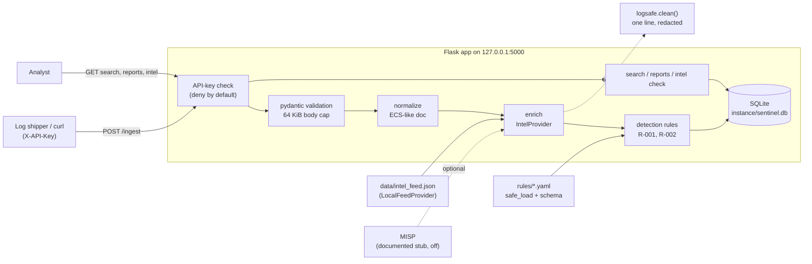

# Sentinel-Lite

A tiny log-enrichment service built for the ULBS Cybersecurity Master lab,
**Module 4: Risk and Damage Management** (AI-driven security engineering).

It accepts security log events over HTTP, normalizes them to a small
ECS-like shape, checks the source IP against a local threat-intel feed,
applies two YAML detection rules, and stores the result in SQLite. An event
from a known-bad IP is tagged `threat.indicator.matched` and gets a higher
risk score; a clean one is left alone.

The service is the small half of the project. The point is the other half:
it was built **deliberately vulnerable** (ten seeded bugs, tag
`baseline-vulnerable`), then guarded (repository, CI and AI-agent controls)
and fixed **one pull request per bug**. The commit history, the risk
register and `docs/BUG-REPORT.md` tell that story together.

## Run it (3 commands)

```bash
make setup    # .venv, pinned dependencies, .env with a random API key
make check    # ruff + pytest + bandit + pip-audit  (about 20-40 s)
make run      # http://127.0.0.1:5000
```

Linux or macOS with Python 3.11+ (on Windows, use WSL). No Docker, no
database server, nothing listens beyond `127.0.0.1`.

```bash
KEY=$(grep ^SENTINEL_API_KEY= .env | cut -d= -f2)
curl -s 127.0.0.1:5000/health
curl -s -X POST 127.0.0.1:5000/ingest -H "X-API-Key: $KEY" -H 'Content-Type: application/json' \
     -d '{"ts":"2026-11-22T07:58:01Z","src_ip":"203.0.113.66","dst_ip":"192.0.2.20","user":"alice","message":"Connection from 203.0.113.66"}'
curl -s -H "X-API-Key: $KEY" "127.0.0.1:5000/events/search?user=alice"
curl -s -H "X-API-Key: $KEY" "127.0.0.1:5000/intel/check?ip=203.0.113.66"
curl -s -H "X-API-Key: $KEY" 127.0.0.1:5000/reports/daily-summary.txt
curl -s -X POST -H "X-API-Key: $KEY" 127.0.0.1:5000/admin/rules/reload
```

| Endpoint | Purpose |
|---|---|
| `GET /health` | Liveness (the only endpoint without an API key) |
| `POST /ingest` | Validate → normalize → enrich from intel → apply rules → store |
| `GET /events/search?user=` | Stored events for one user |
| `GET /reports/<name>` | A generated text report from `reports/` (`make report` writes `summary.txt`) |
| `GET /intel/check?ip=` | Is this IP in the local intel feed? |
| `POST /admin/rules/reload` | Reload and validate `rules/*.yaml` (all-or-nothing) |

## Architecture



## How the repository is guarded

| Layer | Controls |
|---|---|
| Repository | PRs only; `pre-commit` (`no-commit-to-branch`, gitleaks, private keys, large files); pre-push guard against pushes to `main` and force pushes; `governance` workflow that fails if a commit reaches `main` without a merged PR; CODEOWNERS; PR template with a mandatory self-review checklist |
| CI (`ci.yml`) | ruff, pytest, import check, bandit, pip-audit, gitleaks, zizmor; every action pinned to a commit SHA; `permissions: contents: read`; no `pull_request_target` |
| AI agent | `CLAUDE.md` (banned patterns), `memory/` (reviewed corrections), `skills/` (`fix-seeded-bug`, `review-pr`), and enforcement in `.claude/settings.json`: deny rules plus a `PreToolUse` hook that blocks pushes to `main`, force pushes, hook-skipping, secret reads and edits to the guardrails |

**GitHub route used: 4 (GitHub Free + evidence-based governance).** On a
private Free repo, branch protection and rulesets are not available, so
"protected `main`" is made of local hooks plus a detective `governance`
workflow, and the gaps are stated honestly. See `docs/PROJECT.md`.

## Where to look

| | |
|---|---|
| `RISK-REGISTER.xlsx` | 10 risks (Operational / Internal / External), inherent and residual scores, controls, evidence |
| `docs/BUG-REPORT.md` | all ten seeded bugs: introduction, exploit, impact, blast radius, fix, proof, residual risk, plus bug chains |
| `docs/PROJECT.md` | scope, architecture, AI workflow, enrichment evidence, limits, what is not automated |
| `docs/evidence/` | red baseline, green final run, refused pushes, gitleaks refusal, blocked agent actions, CI runs |
| `git log --first-parent main` | one merge per phase / per bug |

Proof on demand: `make evidence-red` re-runs the 38 seeded-bug regression
tests with xfail disabled. On `baseline-vulnerable` they are all red; on
`main` they are all green.
